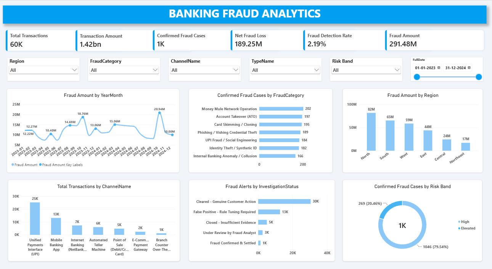
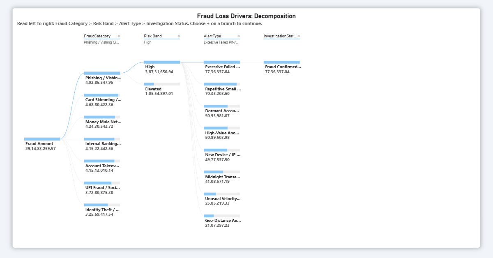

# Banking Fraud Analytics | Power BI Dashboard

An interactive Power BI report that takes a headline fraud KPI and traces it down to the underlying drivers.

> **Note:** All data is synthetic and created for portfolio purposes only. No real bank or customer data is used.

## Key Insight
Gross fraud amount is **291.48M**, but net fraud loss after recovery is **189.25M**. These two numbers tell very different stories about exposure.

## What the Dashboard Covers
- Monthly fraud trend (Jan 2023 to Dec 2024)
- Confirmed fraud cases by fraud category
- Fraud amount by region (North highest at 82M)
- Transaction volume by channel (UPI leads at 25K)
- Fraud alerts by investigation status
- Confirmed fraud cases by risk band (High 79.54%, Elevated 20.46%)
- **Decomposition tree:** Fraud Category > Risk Band > Alert Type > Investigation Status

## KPIs
- Total Transactions: 60K
- Transaction Amount: 1.42bn
- Confirmed Fraud Cases: 1,315
- Fraud Amount: 291.48M
- Net Fraud Loss: 189.25M
- Fraud Detection Rate: 2.19% (Confirmed Fraud Cases / Total Transactions)

## Sample DAX
Fraud Detection Rate = DIVIDE([Confirmed Fraud Cases], [Total Transactions], 0)

## Features
- Slicers for Region, Fraud Category, Channel, Transaction Type, Risk Band and Date range
- All visuals cross-filter dynamically
- Consistent blue theme with clean card-based layout

## Tools
Power BI Desktop, DAX, Data Modelling

## Files
- `Banking_Fraud_Analytics.pbix`
- `/screenshots` (dashboard and decomposition tree)
- `/data` (synthetic dataset)

## Author
**Aquib** | BI & Data Analytics
[LinkedIn](https://linkedin.com/in/aquibtahil/) | [Tableau Public](https://public.tableau.com/app/profile/aquib.tahil8642/vizzes)
